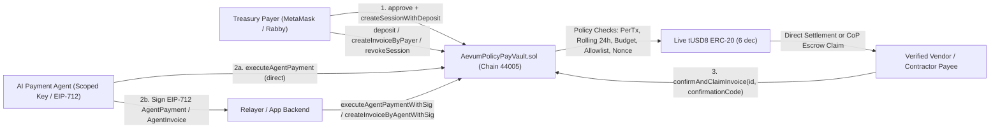
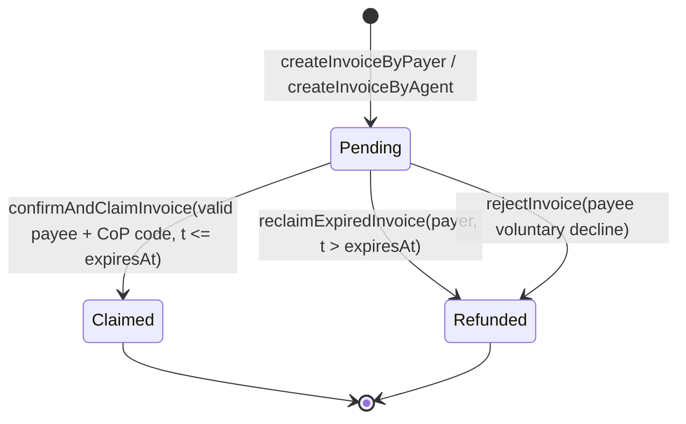

# Architecture — Aevum PolicyPay

## 1. System Overview

**Aevum PolicyPay** unifies three QDay Aevum Builder Challenge payment tracks into one cohesive, on-chain enforced stablecoin payment protocol for **`tUSD8`** (6 decimals, `0x456569838f1d43009A91ebA4263147Afd7233483`) on **QDay Aevum Testnet (Chain ID `44005`)**:

1. **Native AI Assistants (Scoped Session Policy Vault)** — Payers reserve a bounded `tUSD8` budget for an autonomous AI agent signing key, constrained strictly on-chain by `perTxLimit`, rolling 24-hour `dailyLimit`, `totalBudget`, `validUntil` expiry, optional `sessionAllowlist`, monotonic `nonce`, pause switch, and instant `revokeSession` refund.
2. **Confirmation of Payee (CoP)** — Prevents irreversible wrong-address stablecoin burns by binding escrowed payments to `confirmationHash = keccak256(abi.encode(payee, confirmationCode))`. Funds only release when the exact intended `payee` submits the matching out-of-band invoice/payroll reference code.
3. **Invoice & Payroll Escrow** — Both human treasury owners and policy-bounded AI agents can stage escrowed invoices. Payees receive a cryptographic guarantee that funds are locked until `expiresAt`; if a mistyped or unresponsive payee never confirms, the payer safely reclaims 100% of funds after `expiresAt` (even if the vault is globally paused).



## 2. End-to-End Settlement & Guardrail Sequence

```mermaid
sequenceDiagram
    autonumber
    participant P as Payer Treasury
    participant A as AI Agent Signer
    participant V as AevumPolicyPayVault
    participant T as tUSD8 (0x4565...3483)
    participant E as Intended Payee

    P->>T: approve(vault, totalBudget)
    P->>V: createSessionWithDeposit(agent, perTx, daily, budget, validUntil, allowlist)
    V->>T: transferFrom(payer, vault, totalBudget)
    Note over V: totalSessionUnspent += totalBudget

    rect rgba(16, 185, 129, 0.12)
      Note over A,V: Flow A: Scoped Direct / Gasless EIP-712 Agent Payment
      A->>V: executeAgentPaymentWithSig(sessionId, recipient, amount, nonce, deadline, memoHash, sig)
      V->>V: Verify EIP-712 (Chain 44005), non-malleable s, monotonic nonce
      V->>V: Enforce active, !paused, !expired, allowlist, perTx, rolling 24h, budget
      V->>T: safeTransfer(recipient, amount)
    end

    rect rgba(244, 63, 94, 0.12)
      Note over A,V: Flow B: Rogue Overspend or Prompt-Injection Drain
      A->>V: executeAgentPayment(sessionId, attackerOrOverspend, ...)
      V--xA: REVERT PerTxLimitExceeded / DailyLimitExceeded / RecipientNotAllowed
    end

    rect rgba(56, 189, 248, 0.12)
      Note over A,E: Flow C: Confirmation-of-Payee (CoP) Escrow
      A->>V: createInvoiceByAgentWithSig(..., payee, amount, expiresAt, confirmationHash, sig)
      Note over V: totalSessionUnspent -= amount; totalEscrowedInvoices += amount
      E->>V: confirmAndClaimInvoice(invoiceId, confirmationCode)
      V->>V: Verify msg.sender == payee & keccak256(abi.encode(payee, code)) == confirmationHash
      V->>T: safeTransfer(payee, amount)
    end
```

## 3. Invoice / Payroll Escrow State Machine



## 4. Security Controls & Invariants

| Security Property | Mechanism in `contracts/AevumPolicyPayVault.sol` |
| --- | --- |
| **Shanghai EVM Compatibility** | Compiled with `solc 0.8.28`, `evmVersion: "shanghai"` (matching Aevum Testnet's live Shanghai blocks — zero Cancun-only opcodes). |
| **Rolling 24-Hour Daily Cap** | 24 one-hour sliding buckets (`_hourlySpend[sessionId][hour]`), O(1) bounded gas regardless of tx count; prevents midnight boundary double-spend attacks. |
| **EIP-712 Replay & Malleability Protection** | Domain separator dynamically binds `block.chainid` (`44005`) and `address(this)`; strict monotonic `sessionNonces[sessionId]`; rejects `s > SECP256K1N/2` and expired deadlines. |
| **Confirmation of Payee (CoP)** | Binds `keccak256(abi.encode(payee, confirmationCode))` to the exact payee address so leaked codes cannot be front-run by another address and typo'd addresses cannot claim. |
| **Exact Solvency Conservation** | Explicit accounting guarantees `tUSD8.balanceOf(vault) >= totalAvailableLiquidity + totalSessionUnspent + totalEscrowedInvoices` across every state transition (verified by randomized fuzz tests). |
| **Non-Custodial Escape Hatches** | Even under global emergency `pause()`, payers can ALWAYS call `revokeSession()`, `withdraw()`, and `reclaimExpiredInvoice()` — user funds can never be trapped. |
| **Reentrancy & SafeERC20** | Strict Checks-Effects-Interactions (CEI), custom `_lockStatus` reentrancy guard, low-level `.call` transfer checks with balance-delta verification on deposit. |

## 5. Multi-Tenant & Future QDay SDK Alignment

QDay's technical documentation specifies that `@qday-io/sdk` and `https://mcp.qday.io` launch in Q1 2027. **Aevum PolicyPay** works **today** on live QDay Aevum Testnet using standard `viem` + EVM primitives, while mirroring QDay's `PaymentAgent` policy model (`maxSinglePayment`, `maxDailySpend`, `allowedRecipients`, scoped session keys) so existing agent policies seamlessly bridge to QDay Mainnet and ERC-4337/MCP integrations at launch.
